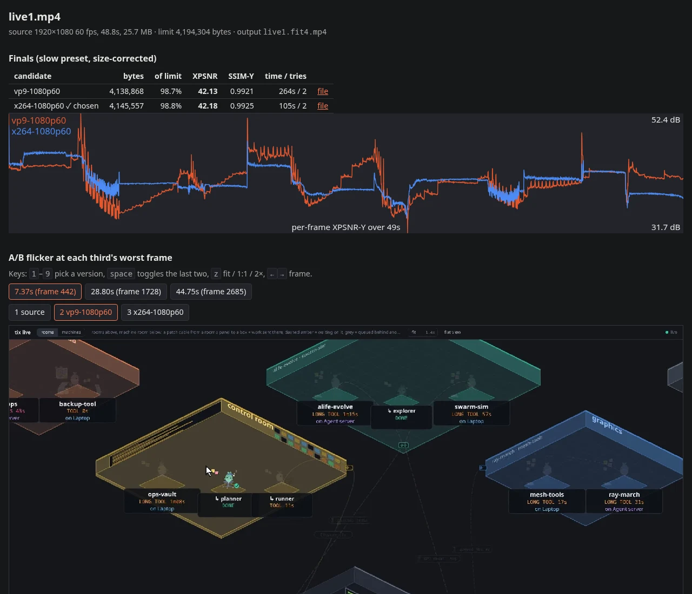

# fit4

Squeeze a video under an upload size limit at the best *measured* quality.

Most "fit my clip under N MB" tools do bitrate arithmetic (size ÷ duration) and
a fixed resolution. fit4 instead encodes the clip several ways (x264 and VP9, a
few resolutions and frame rates), each landed just under the limit. It scores
every candidate against the source with XPSNR and SSIM and keeps the best one.
It also writes an HTML report so you can compare the leaders by eye.



## Run it

You need [uv](https://docs.astral.sh/uv/) and FFmpeg (see below). No install
step: uv fetches and caches fit4 on first use.

```sh
uvx --from git+https://github.com/hiinaspace/fit4 fit4 clip.mp4
```

This writes `clip.fit4.mp4` (or `.webm`, whichever codec won) next to the input,
plus `clip.fit4.d/report.html`. The output path is the only thing printed on
stdout; progress goes to stderr.

```sh
fit4 clip.mp4 --limit 10MB          # any limit: bytes, or B/KB/KiB/MB/MiB
fit4 clip.mp4 -o out.webm           # the suffix picks the codec (.mp4 = x264, .webm = VP9)
fit4 clip.mp4 --no-audio            # drop audio and give its bits to the video
fit4 clip.mp4 --duration 51         # only the first 51 s (also --start 1:30, --end 2:00)
fit4 --help
```

To keep it around: `uv tool install git+https://github.com/hiinaspace/fit4`,
then just `fit4 clip.mp4`.

### Example

A 49 s 1080p60 screen recording (25.7 MB) under the default 4 MiB. Full
resolution and frame rate won here; on busier footage a lower height or frame
rate often does. The screenshot above is this run's report.

```
$ fit4 live1.mp4
live1.mp4: 1920x1080 60fps 48.8s 25.7MB; limit 4,194,304 B → 687 kbps total
screening 16 candidates (4 at a time, fast presets)
  x264-900p30         4.158 MB    673 kbps  XPSNR 37.468  SSIM 0.9798  (19s, 1 tries)
  x264-1080p30        4.154 MB    673 kbps  XPSNR 40.480  SSIM 0.9860  (23s, 1 tries)
  ...
  vp9-1080p60         4.015 MB    673 kbps  XPSNR 41.977  SSIM 0.9919  (169s, 1 tries)
  ...
  vp9-540p60          4.063 MB    695 kbps  XPSNR 33.072  SSIM 0.9681  (99s, 2 tries)
final encodes: vp9-1080p60, x264-1080p60
  x264-1080p60        4.146 MB    650 kbps  XPSNR 42.182  SSIM 0.9925  (105s, 2 tries)
  vp9-1080p60         4.139 MB    694 kbps  XPSNR 42.125  SSIM 0.9921  (264s, 2 tries)
chose x264-1080p60: 4,145,557 B, XPSNR 42.18 (728s total)
  report: live1.fit4.d/report.html
live1.fit4.mp4
```

### FFmpeg requirements

FFmpeg **7.1 or newer** (the `xpsnr` filter first shipped in 7.1), built with
`libx264`, `libvpx` (VP9) and `libwebp`; `aac` and `libopus` when the clip has
audio. Most current packages qualify (for example Homebrew, Arch, Debian 13 and
nixpkgs `ffmpeg-full`); Ubuntu 24.04's packaged 6.1 is too old, but the static
builds linked from <https://ffmpeg.org/download.html> work anywhere.

fit4 checks at startup and names whatever is missing:

```
fit4: ffmpeg 6.1.1 lacks: xpsnr filter (the xpsnr filter arrived in FFmpeg 7.1).
```

If you only lack one encoder, `--codecs x264` or `--codecs vp9` skips the other.

## How long it takes

By default fit4 does not screen the whole grid. A 30-40 s probe (below) predicts
every candidate's quality at the size limit, and only the best one or two (VP9 at
the source frame rate, almost always) get a full size-fitted encode. On the
eval windows (14-30 s of 1080p60 gameplay) that took 18-50% (32% overall) of the time the old
sweep needed (full grid, then finals), for the same XPSNR (never more than 0.00 dB lower) (see
`eval/README.md`). libvpx is still the slow part: one 2-pass VP9 encode of 20 s
of 1080p60 takes about 90 s on 4 threads.

| flag | default | effect |
|---|---|---|
| `--screen MODE` | `none` | what ranks the probe's survivors before the finals: `none` trusts the probe's prediction; `crf` runs one constant-quality encode per survivor at the CRF the probe predicts (about a third of a 2-pass screen's time; its top-3 order matched the 2-pass screen on 5 of 5 tune windows); `2pass` is the old size-fitted 2-pass screen |
| `--finals N` | `2` | most finals. The best-predicted candidate always gets one; a second only if it is predicted within `--finals-margin` of it |
| `--finals-margin DB` | `0.5` | see above |
| `--full-grid` | off | skip the probe and screen every candidate with 2-pass encodes, then final the best (the old behaviour; clips under 10 s do this anyway) |
| `--prune-margin DB` | `1.5` | with `--screen 2pass`/`crf`: screen candidates predicted within this many dB of the best |
| `--prune-keep N` | `4` | ...but always at least the best N predicted |
| `--probe-reel NxS` | `2x2` | probe sample: N slices of S seconds. `3x2` predicts a little better (mean error 0.23 dB against 0.43) for about 30% more probe time |
| `--probe-only` | off | run the probe, write `probe.json` and `prune.json` into the work directory, stop |
| `--codecs x264` | `x264,vp9` | restrict codecs |
| `--fps-divs 1` | `1,2` | skip half-frame-rate candidates |
| `--scales 1,0.667` | `1,0.833,0.667,0.5` | fewer heights |
| `--jobs N` | CPU budget | most encodes at once with `--screen 2pass` |
| `--flat-layout` | off | the old scheduling: `--jobs` (default 4) equal workers sharing the CPUs evenly |

### Pre-flight probe and pruning

Clips of 10 s or more first get a probe: a 4 s sample reel (two 2 s slices
spread over the clip) encoded at three CRFs per geometry with fast settings and
scored with XPSNR, plus a per-second cost timeline from one cheap x264 encode.
From these fit4 predicts each candidate's XPSNR at the limit. It works in stages
and only spends encodes where they can change the outcome:

1. VP9 at every height at the source frame rate, one CRF-63 point each. That
   point's bitrate is libvpx's floor: a VP9 candidate whose budget is under 2x of
   it is dropped outright (libvpx 2-pass cannot get under the limit there; on the
   tune windows the infeasible ones sat at 1.45-1.88x and the feasible ones at
   2.16x and above). One x264 geometry (the middle height) is probed as a pilot.
2. Two more points for each feasible VP9 geometry and for the pilot.
3. The other x264 heights only if the pilot is within 0.5 dB of the best VP9.
   Half-frame-rate VP9 only if an estimate from the reel's judder score (the reel
   against itself at half the rate, frame-doubled) says it could reach the best
   full-rate VP9. Everything not probed is logged with the reason.

Every candidate's decision is logged and written to `prune.json`. If no final
gets under the limit, the rest of the grid is screened; if still none, VP9 is
retried with `-cpu-used 2`, which lowers libvpx's bitrate floor on noisy
footage (about 3x slower on 1080p; it rescued a candidate worth +0.45 dB in one
window at the price of 15 minutes).

### Finals

A final is a 2-pass encode fitted into 97-100% of the limit. Instead of retrying
one bitrate after another, fit4 runs a few bitrates of each finalist side by
side (the budget bitrate and +2% for two finalists; three for one) and keeps the
largest one under the limit; a second round only if none landed in the band. The
first pass is shared between them.

## What the report shows

- **Finals**: the slow-preset encodes, their size as a share of the limit,
  XPSNR and SSIM, and which one was written.
- **Per-frame XPSNR chart** for the finals, to see where each one falls apart.
- **A/B flicker viewer** at the worst frame of each third of the clip: keys
  `1`–`9` pick the source or a candidate, `space` flips between the last two,
  `z` cycles fit / 1:1 / 2×, arrows change frame.
- The final videos, and the full screening table. `results.json` holds the numbers.

## How it works

1. Probe the source and normalize to limited-range bt709 yuv420p (full-range
   `yuvj420p` game and phone captures are the usual offenders).
2. **Pre-flight probe** (clips of 10 s or more): predict every candidate's XPSNR
   at the limit from a short sample, and drop the ones that cannot win or cannot
   fit (above).
3. **Rank** the survivors. By default the prediction itself ranks them
   (`--screen none`); `--screen crf` encodes each once at constant quality and
   moves the measured point to the budget along the probe's slope; `--screen
   2pass` 2-pass encodes each at the size budget, then re-encodes with a
   corrected bitrate until it lands in 95-100% of the limit (libvpx misses its
   target by ±10%), so candidates are compared at equal bytes.
4. **Final** encodes of the best one or two (x264 at `veryslow`, VP9 as in the
   screen), fitted into 97-100% of the limit, **scored** at the source's display
   size and frame rate: XPSNR (reported as (4Y+U+V)/6) and SSIM. Candidates are
   upscaled (bicubic) and frame-duplicated first, so low-resolution and
   low-frame-rate ones pay for what a viewer would see. The higher scorer wins.

Keyframes are spaced about 20 s apart, which suits screen recordings and game
captures with mostly static backgrounds.

## Behaviour worth knowing

- A source that is already under the limit, in an mp4 (H.264/AAC) or webm
  (VP8/VP9, Opus/Vorbis) a site would take, is left alone; `--force` re-encodes.
- Audio is kept by default (AAC 96 kbps in mp4, Opus 64 kbps in webm, at most
  stereo) and its bits come out of the budget. A clip too long to leave a usable
  video bitrate is refused with a suggestion.
- `--board` presets (`4chan`, the default: 4 MiB; `wsg`: 6 MiB) also cap the
  output dimension at 2048 px and warn past a reported maximum duration. These
  limits are community-reported, not official. `--limit` overrides the size.
- XPSNR doesn't model judder, so comparing a 30 fps and a 60 fps candidate by
  score alone is rough. The report's videos are there for that call.

Exit codes: 0 done (or nothing to do), 1 an encode failed or nothing fit,
2 bad arguments or unusable input, 3 FFmpeg missing or lacking a feature,
130 interrupted.

## Development

```sh
uv run pytest        # pure tests, plus a few seconds of real encodes when FFmpeg 7.1+ is on PATH
uv run ruff check && uv run ruff format --check && uv run ty check
```

No runtime dependencies beyond the Python standard library and FFmpeg.

## License

Public domain ([Unlicense](LICENSE)).
